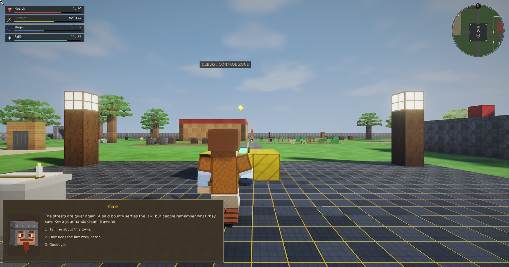
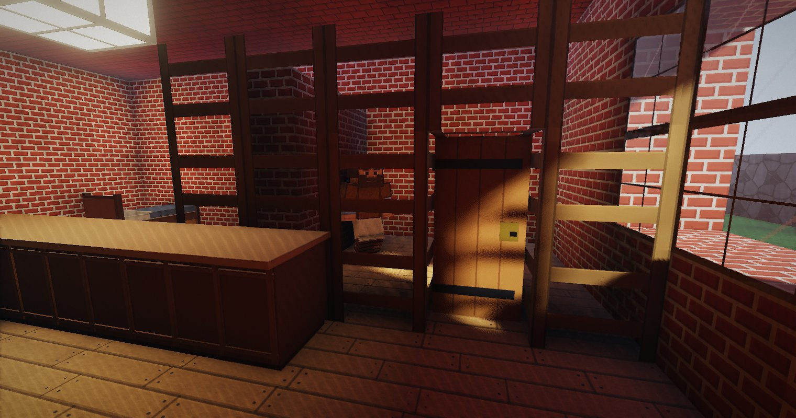
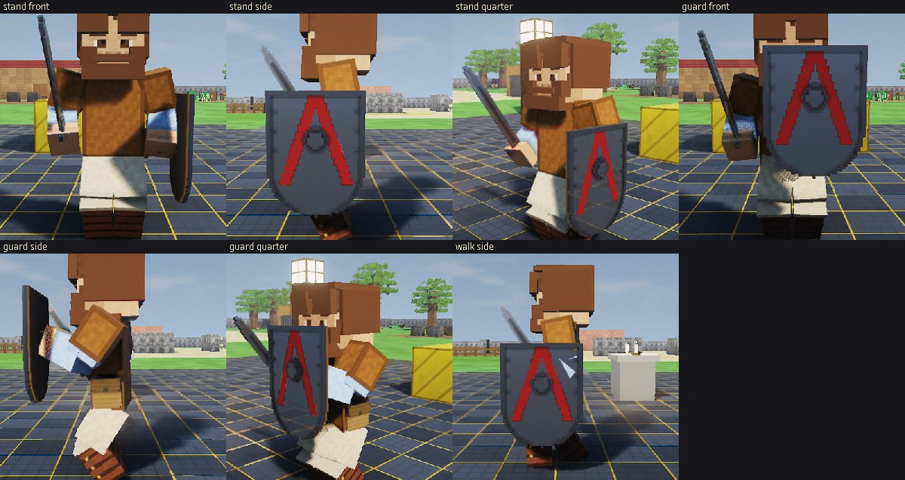
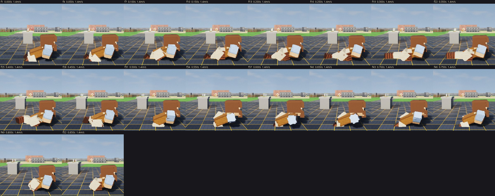
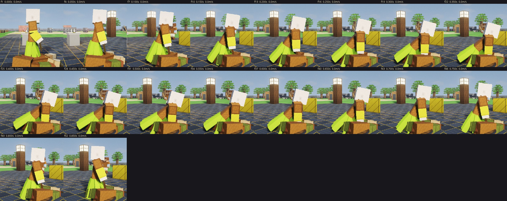

# Launch, custody and presentation review

This pass follows the current request and GDD combat, perception/memory, justice, ecology and persistence rules. Only the player gains XP. Animals and NPCs keep configured skill profiles and derive Level from them. The previous gamefixes list is not the work queue.

## Launch and hardware budget

The supplied Gradle HTML contains deprecation/toolchain warnings, not launch timings. A cold Windows native task previously compiled the DLL, self-test, test module, benchmark and example module before a game could run. The renderer also compiled several expensive world-dependent shaders for a placeholder world, then again for the actual map.

`buildNative` now builds only the runtime DLL/library. Windows uses incremental CMake when available, with a compiler-only fallback; `native/build.bat` without arguments retains the full strict checks. `verifyNative`, required by engine tests/check/build, builds verification tools and runs the native self-test. Runtime jars exclude test/example modules. Shader compilation for world-dependent programs occurs once for the actual world. Startup logs distinguish native services, map construction, renderer/UI creation, the first rendered frame, and session/audio/figure/save loading. Ordinary Java edits do not rebuild native test programs.

The default GPU budget is now 30 FPS and Medium quality, independently of the monitor refresh rate. Dynamic resolution and existing scalable shadow cascades remain active. This targets the requested i5-3570 / GTX 660 / 8 GB / 1080p setup; the cloud machine has software OpenGL, so actual target-hardware FPS and Windows loading time remain unverified.

For repeated play without invoking Gradle each time, build a distribution once from `rpggame`:

```powershell
.\gradlew.bat installDist --no-daemon
.\build\install\rpggame\bin\rpggame.bat
```

Re-run `installDist` after changing source/assets. The distribution still includes the matching engine library.

## Behavior changes

- Blood questions last eight seconds, with a cooldown and renewed interest in genuinely fresh blood. Searches settle their original lead and have an overall deadline. An unrelated newer noise no longer leaves the original case unresolved.
- Missing reaction bodies cannot strand living NPCs indefinitely. Recovery also invalidates navigation goals. Tests exercise Brute navigation into a real attack, and recovery followed by another real attack; a newly spawned Brute already passed the first route test before this pass.
- Criminal opportunists search actual NPC corpses, including worn equipment, as well as exposed player graves. A 0.9-second reach transfers an item at contact. Transfers preserve capacity, ownership and stolen provenance; failed transfers retain the source item. Guards retain their separate secured-grave duty.
- Payment and arrest share legal closure: jurisdiction-specific evidence is settled, involved guards stop swinging/searching, and their airborne ammunition lands instead of disappearing. Personal memories remain, other jurisdictions remain independent, and new offenses still count. Old blood evidence cannot reopen a settled case.
- Both chanceries now have physical cells and stone sleeping slabs. Player custody, sentence deadline and admission count persist. Sleeping on the slab advances the existing world clock and releases the prisoner through the normal sentence path. NPC prisoners also have persisted custody jurisdictions and release normally; shared gates remain locked while another prisoner is still serving time.
- Jail admissions are witnessed memories that can travel through existing rumor conversations. Reactions use what an NPC actually knows, together with Honor; there is no global broadcast of the player's record.
- Sleeping presentation requires an NPC to have stopped at their bed, rather than merely choosing a sleep goal while still walking.
- Arrows use continuous contacts, closest-first before a wall, against the current articulated human pose. A ragdolled head uses its rendered box above the neck, including the corners. Removed limbs leave no ghost volumes. Dead bodies stop arrows without damage/XP rewards. Wounds and reaction impulses use the current pose too.
- Walking starts, stops and turns faster. Bare hands can reduce frontal melee damage, with stamina costs, without weapon parries or arrow blocking. Crouching folds the human rig to approximately half height and sends the matching native collider stance. The engine retains crouch beneath low ceilings; stance updates preserve AI steering. Short crouch steps keep knees bent.
- Shields have a modeled rear grip and enough clearance for the hand in world and first-person views.
- Health, Stamina, Magic and Faith form compact, independently timed rows at top left. The NPC Chatbox replaces the Worldbox while talking: dark textured paper, bold yellow name, cached actual head geometry, mouth motion and gentle floating motion. The native renderer draws the portrait directly in a scissored UI viewport, with no framebuffer readback or per-frame portrait texture uploads.

## Rendering and farm cost

Model bounds are computed once on mesh upload. Camera, forward and shadow passes cull transformed bounds instead of a fixed 4.5-metre sphere for every small part. Bounds conservatively handle rotation, nonuniform scaling, reflection and shear. Near NPCs join existing player/animal contact shadows; all living models retain dynamic sun shadows. Actors do not receive artificial point lights. Animal sensing starts at staggered phases; wild cohort materialization is limited to three animals per batch.

A 30-frame farm sample after 180 settling frames, at matching High quality, full scale and 1520×800 on two-thread llvmpipe:

| Measurement | Before | After |
|---|---:|---:|
| Mean frame | 502.04 ms | 377.36 ms |
| Mean simulation | 2.57 ms | 2.01 ms |
| Models drawn | 185 | 103 |
| Frame p99 | 589.12 ms | 409.51 ms |

That is about 25% less frame time in this short software-rendering sample. Scene behavior changes slightly between runs. These numbers are a relative diagnostic, not a GTX 660 benchmark or proof of 30 FPS on that GPU. Frame pacing and sound mix still need a real Windows play session.

## Audio and source references

Removed the synthesized bow generator and its tests. Bow/crossbow release and arrow impact are downloaded recordings, with per-file provenance from Flare's OpenGameArt credits. The unchanged release asset is 22.05 kHz mono, 0.449 seconds; the engine resamples it for its 44.1 kHz mixer. No claim is made that resampling improves source fidelity. The release is royalty-free CC BY-SA 3.0; the impact is CC0. Credits and the complete release license ship with the assets. Existing recorded creaks and swishes supply draw/fly-by sounds.

References consulted, with game-specific implementation rather than imported gameplay frameworks:

- [Gradle incremental inputs/outputs](https://docs.gradle.org/8.14.3/userguide/incremental_build.html): distinguish launch runtime outputs from verification tools.
- [CMake build targets](https://cmake.org/cmake/help/latest/manual/cmake.1.html#build-a-project): incremental compilation and building only the runtime target.
- [LearnOpenGL transformed bounding volumes](https://github.com/JoeyDeVries/LearnOpenGL/blob/master/includes/learnopengl/entity.h): transform extents conservatively before frustum rejection.
- [Khronos scissor semantics](https://registry.khronos.org/OpenGL-Refpages/gl4/html/glScissor.xhtml): confine portrait rendering and its depth clear to the UI rectangle.
- [Flare per-file credits](https://github.com/flareteam/flare-game/wiki/Credits): identify the original recordings and individual licenses, rather than assuming the repository's code license covers audio.

## Verification and visual review

Linux game/engine builds pass with 76 game tests and 22 engine tests (including software-OpenGL rendering). Both strict and sanitizer native runs pass 110 checks. Scoped PMD unused-local/private-field/private-method rules report no findings for game and engine main/test source sets. Address/UndefinedBehavior sanitizers report no failures. Windows CI builds the matching engine/game pair with MSVC warnings treated as errors. Its hosted runner explicitly skips the GPU test; Linux exercises that test with a real software OpenGL context. The full historical graphical acceptance tour is not claimed as re-run.

Exact production source `6eeb653ba8f89f118708db7ff970a891363f37e0` passed [Windows CI run 40007050599](https://github.com/itsJito/ProjectRPG/actions/runs/40007050599) in 3m 30s: engine build/native verification and game build/regressions. Windows GPU rendering remains explicitly skipped on that hosted runner. Linux rendering and all 22 engine tests passed without skips.

The installed distribution also launched successfully into its menu in a timed smoke check. Warm-cache cloud phase logs were: native services 0.01s, devmap 0.01s, renderer/UI 0.38s, first rendered frame 0.39s. These are individual phase measurements on software OpenGL, not a Windows cold-start benchmark. `installDist` completed in 5s with already-built runtime inputs; the launch task graph did not include `verifyNative`.


The real renderer supplied reference stills and animation frames 1, 4, 7, 10, etc. Review caught and corrected excessive crouch lean, trailing-leg extension, a patterned paper texture, insufficient shield-hand clearance, and a looting fixture without a visible corpse. Both build and movement regressions caught and corrected stance input overwriting AI movement. Numerical art scores would be subjective; these captures provide reviewable evidence rather than a promised 10/10 rating.







Reproduce the targeted review from `rpggame` (POSIX; environment variables can also be set in PowerShell):

```sh
RPG_GALLERY_ONLY=session-polish sh gradlew gallery -PgalleryDir=build/review-session
RPG_GALLERY_ONLY=session-polish RPG_REVIEW_ONLY=motion sh gradlew gallery -PgalleryDir=build/review-motion
RPG_GALLERY_ONLY=session-polish RPG_REVIEW_ONLY=loot sh gradlew gallery -PgalleryDir=build/review-loot
RPG_GALLERY_ONLY=locomotion sh gradlew gallery -PgalleryDir=build/review-locomotion
RPG_BENCH_ONLY=farm RPG_BENCH_FRAMES=30 RPG_BENCH_SETTLE=180 RPG_BENCH_TARGET=144 RPG_BENCH_QUALITY=2 sh gradlew bench
```

Only a small JPEG review set is committed; the full screenshot batches and generated binaries remain outside source control. The unused-code audit is scoped to the enabled PMD rules, not a proof that every public API or runtime branch in the entire repository is reachable.
