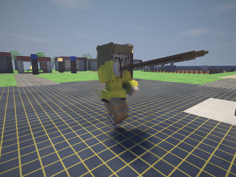
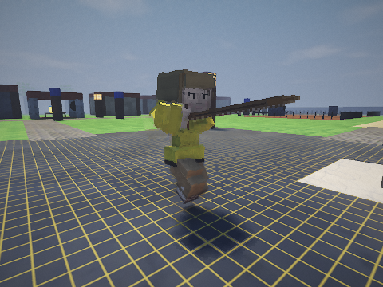
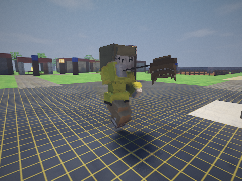
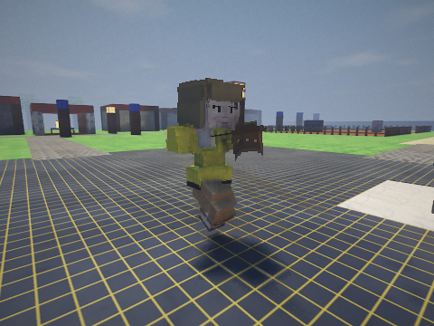
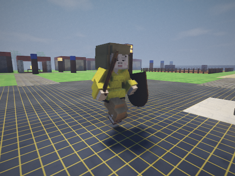

# Alpha 0.2.8: A Helping Hand — Shadow

Base: `polish` at `da70afe` (Alpha 0.2.7). Work and publication remain on `polish`.

## Architecture and scope

The Gradle composite retains the Java 21 gameplay layer, shared procedural human rig, and native engine physics/rendering. Node gathering still uses physical weapon contact; repair remains interruptible Work; food changes real inventories; law and personal memory retain separate responsibilities. NPC skills/combat levels remain fixed. Existing run/jog animation and authored lore/items are retained. The native API layout stays at 2.7.

| Requested issue | Implementation and evidence |
|---|---|
| Inverted NPC mining/swinging | A committed work swing retains its heading despite residual motion or a stale native hold heading; mining uses the shared overhead stroke. Native-backed tests require ore contact from four sides and unchanged NPC XP |
| Two-Handed Swords and Battleaxes | Both arms solve one handle with separate grip offsets. Reach includes the inner and outer arm limits; the raised wind-up keeps the blade above the head. Tests sample every strike across three bodies, both sex presets and first/third person |
| Shields | Held rendering uses the rig's full wrist/torso frame, including forearm tilt, instead of rebuilding it from world up and actor yaw |
| Tree roots obscured by foliage | Growing patches reject the neighbouring ring of a living tree or Stump; wall growth cannot cover the first trunk block |
| Misaligned foliage | Ivy requires backing across its height; Ivy/Moss sit close to the wall and carry rigid metadata through the shared foliage batch, so wind and body pushers do not detach them |
| Stale witness HUD | Notices and appeals distinguish personally pending evidence from reported incidents, withheld accounts and settled cases. A second eyewitness disappears from pending notices once that incident reaches the watch |
| Stuttering | Repeated region searches reuse cached exits; source/neighbour topology edits invalidate them and each request rechecks door permissions. Region A* avoids broad unrelated scans. Matched timings are below |
| Undertaker self-reference | An Undertaker collecting remains describes his own task rather than promising to take them to Morrow |
| Memory recollection | Appeal flags survive stronger-source merging; closure can travel to someone who already remembers the incident without erasing their eyewitness source. Spoken recollections include personal victim/closed-case context. Legacy incidents without event IDs have distinct persisted report identities |
| Bread/chat choices | Bread is offered contextually and transferred through a checked interaction with replay protection, capacity, readiness, range and sight validation. Conversation replies revalidate participants, range and sight. The rendered review exercises 88 informational replies across 67 human NPCs; trade, payment, bank and quest transactions have their existing gameplay regressions |
| Active 14 Gold bounty described as settled | Officer dialogue reads the live jurisdiction bounty before describing old memories. Regression covers the exact amount, available payment and case closure |
| Repair/building pose | Existing Hammer animation now has a slower lift, short downstroke, bracing hand, and near-surface contact target, with entry/exit blends tied to Work |
| Nearer fog | Noon bank moves from 70–132 m to 48–90 m; the far plane follows the complete bank by 6 m. Weather/time bring it nearer, and its minimum is 40 m rather than 90 m |
| DevMap Stairs/Ladders | Existing connected stair flight, backed Ladder and upper platform are preserved and marked. Native movers must actually arrive on that course, with the stair mover forbidden from using ladders |
| Dead code | PMD's eight unused-local findings, plus the resulting unused gallery yaw, are removed. The game Java unused-local/private-field/private-method audit passes |

## Verification

| Check | Result |
|---|---|
| Full gameplay sweep | 339 passed; zero failures/errors; one existing profiling probe skipped |
| Closing render/foliage checks after the final opacity-marker correction | 35 passed; zero failures/errors |
| Closing affected checks, including corrected routine fixture and GL menu | 14 passed |
| Native engine self-tests | 121 passed |
| Engine Java/GL tests | 29 passed |
| Game distribution | Built successfully |
| Packaged executable startup | Native services, renderer/UI, first frame and engine intro rendered; timeboxed after 15 seconds |
| PMD 7.28.0 game Java unused-code audit | Zero violations |
| Native-rendered human dialogue review | 67 people; 88 informational replies passed |

The routine-work test originally included live predators: a trace showed Corwin fleeing wolves and hiding from coyotes rather than fishing. Its fixture now follows the existing quiet-workday test pattern by unloading animals/monsters, while retaining every trade/attendance assertion. Separate threat-response tests retain live threats. GL checks require an active display; the final run uses the virtual display rather than a headless assumption or disabled test. One existing profiling probe remains deliberately disabled.

## Matched CPU measurements

Same Linux host, native engine, JDK 21 and game JVM settings: 512 MiB initial/2 GiB maximum heap, pre-touch and ZGC. Three fresh JVM runs per version, alternating original and updated code. Each run uses 60 warm-up ticks, 360 measured simulation ticks, then 80 repeated DevCity-to-DevPalace route queries. No renderer or concurrent build is included. Original Java sources are compiled from `da70afe`; the final sources use the same engine binary/API.

| Metric | Original, median of three runs | Alpha 0.2.8, median of three runs |
|---|---:|---:|
| Simulation median tick | 4.996 ms | 3.290 ms |
| Simulation p99 tick | 80.994 ms | 30.564 ms |
| Worst simulation tick | 165.349 ms | 42.317 ms |
| Total for 80 repeated routes | 612.363 ms | 124.189 ms |
| Successful repeated routes | 80/80 in each run | 80/80 in each run |

Repeated routes are approximately 4.9 times faster in this workload; the p99 simulation tick decreases by approximately 62%. This short session probe includes startup/cache effects and does not establish a uniform frame-rate guarantee. Remaining spikes, synchronous cold chunk construction, rendering cost and hardware performance still require representative play-session profiling. Software-rendered captures establish appearance and functional rendering, not GPU throughput.

## Visual review

Native-renderer reference captures were taken before edits. Reviewed final captures include the greatsword and battleaxe wind-up/strike/recovery, pickaxe stroke, Shield carrying/blocking, the complete 3.5-second repair Work, living tree roots, nearer noon fog, the connected traversal course, contextual Bread offer, reported-witness HUD and 14 Gold dialogue.

Motion sheets sample frames 1, 4, 7 … 58; repair samples frames 1, 4, 7 … 208. All 70 repair samples were inspected across nine contact pages. Review focuses on hand contact, reachable arms, head/body clearance, a readable lift/impact/recovery, and stable surface attachment. A first two-hand pass failed the skinny body's inner arm-reach limit; a second inspection caught a rearward blade near the head. Both were corrected and the final sampled poses rechecked. Wall-growth inspection also caught a negative metadata marker forcing the whole foliage batch into the forward/translucent pass. The final marker stays positive, above the packed root range; an additional generated-mesh regression checks the native uploader's opacity contract. Animation is kept restrained and consistent with the existing block-model style.

A compact set of reviewed captures is retained below. The tools reproduce the complete motion sheets and repair contact pages without storing all large galleries in the source tree.

| Pose | Alpha 0.2.7 reference | Alpha 0.2.8 |
|---|---|---|
| Two-Handed Sword |  |  |
| Battleaxe |  |  |
| Shield carrying |  |  |

[Tree roots](alpha028/grove-roots.png) · [Attached Ivy](alpha028/wall-growth.png) · [Bread offer](alpha028/bread-offer.png) · [Reported-witness HUD](alpha028/reported-witness-hud.png) · [14 Gold dialogue](alpha028/fourteen-gold.png) · [Stairs and Ladder](alpha028/stairs-ladder.png)

Reproduce:

```sh
cd rpggame
sh gradlew test installDist pmdMain --init-script tools/unused-code.gradle
cd ..
python3 rpggame/tools/alpha028/review.py profile
python3 rpggame/tools/alpha028/review.py poses --out work/alpha028/poses
python3 rpggame/tools/alpha028/review.py scenes --out work/alpha028/scenes
```

Use JDK 21 and a real or virtual OpenGL display for rendered checks. `--only repair` selects the full repair capture; `--only greatsword,battleaxe` selects those motions; scenes accept one scene name such as `grove-roots` or `fourteen-gold`. Profiling does not require a display. The runner supplies the same heap/ZGC arguments used for the matched measurements.
